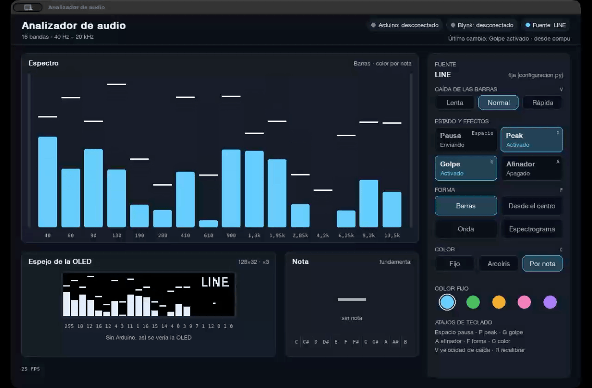

# Analizador de Espectro de Frecuencias


Sistema que traduce la música en luz: la computadora analiza el audio en tiempo real y un **Arduino Uno** lo muestra en una **pantalla OLED**.

Proyecto final del **Taller de Introducción a la Ingeniería Eléctrica (TallerInE Robótico)** — IIE, Facultad de Ingeniería, Universidad de la República.

## Contenido

- [Descripción](#descripción)
- [Stack tecnológico](#stack-tecnológico)
- [Inicio rápido](#inicio-rápido)
- [Uso](#uso)
- [Roadmap](#roadmap)
- [Estructura del repositorio](#estructura-del-repositorio)
- [Documentación](#documentación)
- [Hardware](#hardware)
- [Equipo](#equipo)

---



## Descripción

Un programa en Python captura el audio de la computadora (el micrófono o lo que suena en ella), lo divide en 16 bandas de frecuencia y le manda las alturas de las barras a un Arduino Uno, que las dibuja en una OLED de 128×32. Los modos de visualización se controlan desde la ventana de la computadora, desde una caja con botones físicos y, más adelante, desde una app de **Blynk**.

El objetivo del proyecto:

> Desarrollar un sistema basado en Arduino Uno que, a partir del análisis en tiempo real de la música realizado en una computadora, la traduzca en patrones de luz, con varios modos de visualización seleccionables desde una aplicación que respondan a distintas características del sonido, como el volumen por banda de frecuencia o la nota o tonalidad predominante.

**Características:**

- **Análisis de espectro en tiempo real:** FFT de 16 bandas entre 40 Hz y 20 kHz, con calibración automática para que se vea bien con música fuerte o suave, y recalibración manual.
- **Dos fuentes de audio:** el micrófono o lo que suena en la propia computadora.
- **Modos combinables:** forma (barras, desde el centro, onda o espectrograma) × color (fijo, arcoíris o según la nota que suena). La OLED muestra barras o desde el centro; con onda y espectrograma, muestra barras.
- **Efectos:** marca de pico, destello con cada golpe del bombo y tres velocidades de caída de las barras.
- **Control desde tres lugares sincronizados:** la ventana de la computadora, los botones de la caja y la app de Blynk. La computadora es la única dueña del estado.
- **Visualizador en la computadora:** el espectro en alta resolución, un espejo de la OLED y un panel de control.
- **Funciona sin Arduino:** si no está conectado (o se desconecta), el análisis y el visualizador siguen andando.

## Stack tecnológico

| Parte | Tecnología |
|---|---|
| Programa de la computadora | **Python 3.14** con `numpy` (FFT), `sounddevice` (captura de audio), `pyserial` (puerto serie), `pygame-ce` (visualizador) y `requests` (Blynk) |
| Firmware | **Arduino (C++)** con las librerías *Adafruit SSD1306* y *Adafruit GFX* |
| App | **Blynk** |
| Audio del sistema | **BlackHole** en macOS; fuente "monitor" de PulseAudio/PipeWire en Linux |

## Inicio rápido

**Requisitos previos:**

- macOS o Linux con **Python 3.14** y **Git**.
- **Arduino IDE** y un **Arduino Uno** con la OLED (opcional: sin Arduino se puede probar el análisis y el visualizador).
- En macOS, **BlackHole** para analizar el audio del sistema.

**Instalación:**

```bash
git clone https://github.com/eltruji04/analizador-audio.git
cd analizador-audio
python3 -m venv .venv
source .venv/bin/activate
pip install -r requirements.txt
```

Después hay que cargar el firmware en el Arduino y ajustar el puerto serie y los dispositivos de audio en [`pc/configuracion.py`](pc/configuracion.py). Los pasos completos (BlackHole, Linux, firmware y comprobaciones) están en [docs/instalacion.md](docs/instalacion.md).

## Uso

```bash
source .venv/bin/activate
python pc/principal.py
```

Se abre la ventana del visualizador y empieza el análisis. Si encuentra el Arduino, le manda los datos; si no, sigue funcionando sin él. Se cierra con la ✕ de la ventana o con **Ctrl+C** en la terminal.

> El Monitor Serie del Arduino IDE tiene que estar cerrado: si no, ocupa el puerto.

**Desde la ventana** (con el teclado o haciendo clic en el panel de la derecha):

| Tecla | Acción |
|---|---|
| `Espacio` | Pausa: deja de enviar al Arduino (la compu sigue analizando) |
| `P` | Marca de pico |
| `G` | Efecto de golpe |
| `V` | Velocidad de caída: lenta → normal → rápida |
| `F` | Forma: barras → desde el centro → onda → espectrograma |
| `C` | Color: fijo → arcoíris → por nota |
| `A` | Afinador en la tarjeta de nota |
| `R` | Recalibrar piso y techo desde lo que suena ahora |

El color fijo se elige con las muestras del panel.

**Desde la caja de control:**

| Botón | Acción |
|---|---|
| 1 | Velocidad de caída |
| 2 | Pausa |
| 3 | Marca de pico |
| 4 | Efecto de golpe |

La fuente de audio (micrófono o sistema) se elige antes de iniciar con `FUENTE_AUDIO` en [`pc/configuracion.py`](pc/configuracion.py). Ahí están también el puerto serie, los dispositivos de audio y la calibración: ver [Configuración](docs/instalacion.md#configuración).

## Roadmap

**Hecho**

- [x] Captura de audio del micrófono o del sistema (BlackHole), elegido por nombre de dispositivo
- [x] FFT de 16 bandas con ventana deslizante de 4096 muestras
- [x] Calibración automática por banda y recalibración manual (tecla `R`)
- [x] Suavizado de barras con tres velocidades de caída y marca de pico
- [x] Detección de golpe del bombo y destello en las barras 1, 2, 15 y 16
- [x] Paquete serie de 22 bytes a la OLED y lectura de los 4 botones
- [x] Estado único compartido entre la ventana, el Arduino y Blynk
- [x] Visualizador: 4 formas, 3 modos de color, espejo de la OLED y panel de control
- [x] Firmware: barras, marca de pico, MIC/LINE, nota y pausa en la OLED; botones con antirrebote
- [x] El programa sigue funcionando sin Arduino o si se desconecta

**Por hacer**

- [ ] Estimación de la nota y afinador (`pc/nota.py`)
- [ ] Conexión con Blynk y tablero de registro de uso (`pc/blynk_cliente.py`)
- [ ] Firmware: leer el byte 21 del paquete y dibujar las barras desde el centro
- [ ] Firmware: LEDs indicadores de la fuente de audio (micrófono / sistema)
- [ ] Cambiar la fuente de audio en vivo (hoy se elige antes de iniciar)
- [ ] Probar la detección de golpe con música real
- [ ] Probar la instalación en Linux
- [ ] Armar la caja de control
- [ ] Medir el retardo entre el sonido y la pantalla

## Estructura del repositorio

```
analizador-audio/
├── pc/                         # Programa de la computadora (Python)
│   ├── principal.py            # Punto de entrada: captura, análisis, envío y visualizador
│   ├── configuracion.py        # Todos los parámetros del programa
│   ├── estado.py               # Estado compartido (modos, pausa, pico…) y últimos resultados
│   ├── captura.py              # Captura de audio con sounddevice
│   ├── bandas.py               # FFT por bandas, calibración, suavizado y picos
│   ├── golpe.py                # Detección de golpes del bombo
│   ├── nota.py                 # Estimación de la nota (pendiente)
│   ├── serie.py                # Paquete al Arduino y lectura de botones
│   ├── blynk_cliente.py        # Conexión con Blynk (pendiente)
│   ├── visualizador.py         # Ventana: eventos, teclas y bucle de dibujo
│   ├── dibujo.py               # Dibujo de cada zona de la ventana
│   └── colores.py              # Paleta y color de cada banda
├── arduino/
│   └── botones_oled/
│       └── botones_oled.ino    # Firmware: OLED y botones
├── docs/                       # Documentación del proyecto
└── requirements.txt            # Dependencias de Python
```

## Documentación

| Documento | Contenido |
|---|---|
| [Instalación y configuración](docs/instalacion.md) | Entorno en macOS y Linux, captura del audio del sistema, firmware, parámetros y pruebas |
| [Diseño del sistema](docs/diseno.md) | Arquitectura, hardware, modos, Blynk, visualizador y procesamiento de audio |
| [Funcionamiento del código](docs/codigo.md) | Módulos, hilos, recorrido de un bloque de audio, funciones principales y cómo agregar cosas |
| [Protocolo serie](docs/protocolo_serie.md) | Formato de los mensajes entre la computadora y el Arduino |
| [Guía de Git](docs/guia_git.md) | Cómo trabaja el equipo con Git y GitHub |

## Hardware

| Componente | Cantidad |
|---|---|
| Arduino Uno | 1 |
| OLED 128x32 I2C (SSD1306) | 1 |
| Pulsadores | 4 |
| LEDs indicadores con resistencia | 2 |
| Caja de control | 1 |

Conexiones y funciones en [Diseño del sistema → Hardware](docs/diseno.md#hardware).

## Equipo

| Integrante | Área |
|---|---|
| Santiago Trujillo | Software en la computadora (Python) |
| Lucía Hernández | Firmware del Arduino, protocolo serie y pantalla OLED |
| Benjamín Cabrera | Hardware, construcción y Blynk |
